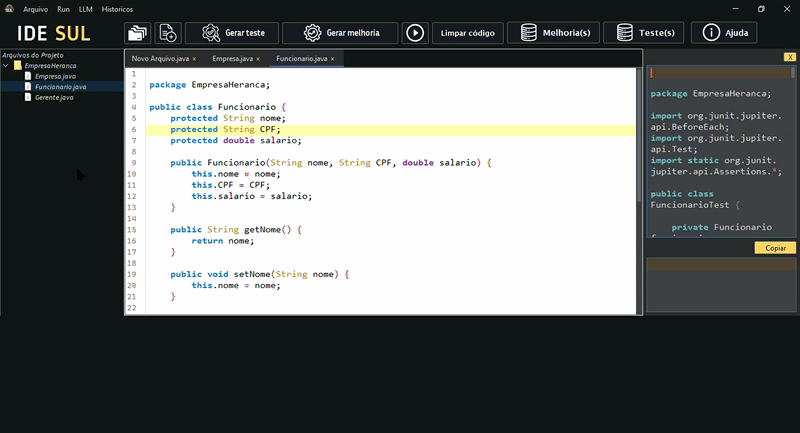

# Trabalho de Graduação – Portfólio

**Fatec Professor Jessen Vidal – São José dos Campos**

**Curso:** Análise e Desenvolvimento de Sistemas

**Aluno:** Lincoln Borsoi Moreira

**Orientador:** Gildarcio Sousa Gonçalves

---

## 1. Apresentação do Aluno

### Foto

### Informações Pessoais

- **Nome completo:** Lincoln Borsoi Moreira
- **Idade:** 21 anos

### Curso

Análise e Desenvolvimento de Sistemas – Fatec São José dos Campos (Fatec-SJC), cursado desde o segundo semestre de 2024, com previsão de conclusão no segundo semestre de 2027.

### Histórico Acadêmico

- **Fatec São José dos Campos** – Tecnologia em Análise e Desenvolvimento de Sistemas (2024 – atual)
- **Colégio Comercial Caçapava** – Curso Técnico em Informática integrado ao Ensino Médio (2021 – 2023)

### Motivação para Entrar na Fatec

Após concluir o Curso Técnico em Informática integrado ao Ensino Médio, quis dar continuidade aos meus estudos em tecnologia e aprofundar meus conhecimentos em desenvolvimento de sistemas. Escolhi a Fatec por oferecer o curso de Análise e Desenvolvimento de Sistemas, que combina uma base teórica sólida com a prática, e por ser uma instituição de referência na formação de profissionais para o mercado.

Também me motivou a oportunidade de ingressar em uma área emergente e promissora, com grande demanda por profissionais qualificados e muitas possibilidades de crescimento, como o desenvolvimento de software e a inteligência artificial.

### Histórico Profissional

| Empresa | Período | Cargo | Atribuições |
|---------|---------|-------|-------------|
| Nestlé | 02/2026 – atual | Aprendiz (área de SHE – Segurança do Trabalho e Meio Ambiente) | Atendimento diário a colaboradores e montagem de planilhas e dashboards em Excel e BI para acompanhamento de indicadores da área. |

Ainda não atuei profissionalmente na área de desenvolvimento de sistemas e estou em busca de oportunidades em desenvolvimento de software e inteligência artificial.

### Informações de Contato

- 📧 E-mail: [lincolnborsoimoreira@gmail.com](mailto:lincolnborsoimoreira@gmail.com)
- 💻 GitHub: [github.com/Dollar2006](https://github.com/Dollar2006)
- 🔗 LinkedIn: [linkedin.com/in/lincolnborsoimoreira](https://www.linkedin.com/in/lincolnborsoimoreira)

### Principais Conhecimentos

- **Linguagens e frameworks:** Python, Java, TypeScript, JavaScript, HTML, CSS, React, Flask, FastAPI, Django
- **Bancos de dados:** SQL, PostgreSQL, MySQL, Supabase
- **Inteligência artificial:** Ollama (execução de modelos de linguagem locais), integração com LLMs (Gemini)
- **Ferramentas e metodologias:** Scrum, Jira, Git e GitHub, Figma, Docker Desktop, Design Patterns

---

## 2. Projetos API

| Semestre | Empresa Parceira | Solução Desenvolvida |
|----------|------------------|----------------------|
| [Primeiro Semestre – 2024-2](#projeto-1) | Fatec-SJC (Prof. Antônio Egydio) | Site web para ensino de Scrum com conteúdos e quiz, hospedado na AWS |
| [Segundo Semestre – 2025-1](#projeto-2) | Fatec-SJC (Prof. Giuliano Bertoti) | IDE para Java com IA integrada: execução, geração de testes e sugestões de melhoria |
| [Terceiro Semestre – 2025-2](#projeto-3) | Entrenova | Plataforma web de diagnóstico empresarial com chatbot de IA, relatórios e trilhas de treinamento |
| [Quarto Semestre – 2026-1](#projeto-4) | 6º BIL (Exército) | Plataforma web que gera memorial de cálculo e especificações técnicas a partir de plantas CAD |

---

### Primeiro Semestre – 2024-2 — Academia Ágil Scrum

#### Empresa Parceira

Fatec São José dos Campos – Prof. Antônio Egydio (responsável pelos requisitos)

#### Problema

O cliente deseja adotar o Scrum em sua empresa, mas seus funcionários ainda não dominam a metodologia e não têm um material único e acessível para aprendê-la. O conteúdo sobre os conceitos, os artefatos e os exemplos práticos do Scrum fica espalhado, o que dificulta o estudo e a aplicação correta no dia a dia. Além disso, não há uma forma simples de verificar o que cada colaborador aprendeu, o que impede o acompanhamento da evolução da equipe e atrasa a adoção do Scrum na empresa.

#### Solução

Para resolver o problema proposto, a equipe desenvolveu a **Academia Ágil Scrum**, uma aplicação **web** voltada ao ensino da metodologia ágil Scrum. O sistema reúne telas de Home e de Conteúdos, com fundamentos, artefatos e exemplos práticos do Scrum, e um quiz para o usuário testar o que aprendeu. O site foi desenvolvido em Flask e hospedado em uma instância da AWS.

Detalhes

**Tela Módulos**

**Tela Quiz**

#### Link do Repositório

[github.com/Omega-Tech-API/API](https://github.com/Omega-Tech-API/API)

#### Tecnologias Utilizadas

| Tecnologia | Onde foi utilizada |
|------------|--------------------|
| Python + Flask | Back-end do site, rotas e execução da aplicação |
| HTML, CSS e JavaScript | Telas Home, Conteúdos e Quiz (front-end) |
| AWS | Hospedagem do site em instância na nuvem |
| Figma | Wireframes e design das telas |
| Jira | Gestão do backlog e das sprints |
| Notion | Documentação e organização |
| Git e GitHub | Controle de versão e repositório da equipe |
| VS Code | Ambiente de desenvolvimento |

#### Contribuições Pessoais

Nesse projeto atuei como **Product Owner** e fui responsável pela escrita e priorização do backlog do produto no Jira, com a definição dos épicos e das user stories de cada sprint. Participei da escolha das tecnologias do projeto, como Flask para o back-end e a hospedagem em instância da AWS. Conduzi as conversas com o cliente, o Prof. Antônio Egydio, para levantar e validar os requisitos de cada sprint. Desenvolvi o design inicial das telas Home, Módulos e Quiz no Figma, que serviu de base para a implementação em HTML e CSS. Também montei os vídeos demonstrativos entregues ao final de cada sprint. Os artefatos gerados foram o backlog do produto, os épicos e user stories, o design das telas e os vídeos demonstrativos.

#### Hard Skills

| Tecnologia | Nível de proficiência |
|------------|-----------------------|
| Python | faço/uso com autonomia |
| HTML | consigo ensinar |
| CSS | consigo ensinar |
| Figma | faço/uso com autonomia |
| Jira | faço/uso com autonomia |
| Git | faço/uso com autonomia |
| GitHub | faço/uso com autonomia |

#### Soft Skills

- **Adaptabilidade:** No primeiro semestre, a equipe tinha pouca experiência com programação, e o grupo distribuiu funções que tirassem cada um da zona de conforto. Fui colocado como Product Owner desde o início, apesar da minha timidez e da dificuldade em me comunicar. Na primeira entrevista com o cliente, o Prof. Antônio Egydio, cheguei despreparado e recebi uma chamada de atenção por isso. Em vez de me abalar, passei a preparar cada reunião com antecedência, levando os pontos do backlog e as dúvidas sobre os requisitos da sprint. Na última entrevista, conduzi a conversa com confiança, sabendo o que precisava apresentar e validar.

- **Pensamento Crítico:** Sabendo que a equipe ainda estava aprendendo e evoluindo ao longo do semestre, decidimos tratar o design do sistema como algo a ser melhorado a cada sprint, e não como algo fechado desde o início. Ao final da Sprint 1 e novamente ao final da Sprint 2, eu, como Product Owner, e os demais membros analisamos o resultado e concluímos que o design ainda não estava bom o suficiente. Por isso o design foi refeito várias vezes, e na Sprint 3 entregamos o redesign visual das telas, que chegou ao resultado final do site.

---

### Segundo Semestre – 2025-1 — IDE-SUL

#### Empresa Parceira

Fatec São José dos Campos – Prof. Giuliano Bertoti (responsável pelos requisitos)

#### Problema

O cliente é desenvolvedor e precisa escrever casos de teste para os seus códigos com frequência. Hoje ele recorre a chatbots online, como ChatGPT e Gemini, mas a interface de conversa não é adequada para esse trabalho: a cada código novo, ele precisa copiar o trecho para o chatbot, pedir os testes, levar a resposta de volta para o ambiente de desenvolvimento e repetir o processo, o que consome tempo. Além disso, esses serviços online não oferecem privacidade sobre o código enviado, o que o deixa inseguro em compartilhar seus projetos com ferramentas de terceiros.

#### Solução

Para resolver o problema proposto, a equipe desenvolveu a **IDE-SUL**, uma aplicação **desktop** que integra um editor de código Java a modelos de linguagem de IA locais. O sistema executa o código e mostra a saída em um terminal, gera testes unitários e analisa seus resultados, sugere melhorias no código e mantém o histórico de prompts e respostas.

#### Link do Repositório

[github.com/Equipe-SUL/IDE-SUL](https://github.com/Equipe-SUL/IDE-SUL)

#### Tecnologias Utilizadas

| Tecnologia | Onde foi utilizada |
|------------|--------------------|
| Java | Desenvolvimento da IDE, editor de código e execução dos testes |
| NetBeans | Ambiente de desenvolvimento do projeto |
| Ollama | Execução dos modelos de linguagem que geram testes, análises e melhorias |
| MySQL | Persistência do histórico de prompts e respostas |
| Figma | Protótipo da interface principal |
| Jira | Gestão do backlog e das sprints |
| Git e GitHub | Controle de versão e repositório da equipe |

#### Contribuições Pessoais

Nesse projeto atuei como **Scrum Master** e apoiei o Product Owner na definição das tecnologias do projeto, como o Java para o desenvolvimento da IDE e o Ollama para executar a IA localmente. Ajudei no desenvolvimento dos prompts e na aplicação dos casos de teste na IA, principalmente no início do projeto, quando ninguém na equipe tinha muito conhecimento dessa tecnologia. Também defini, junto com os membros do time, prazos de entrega condizentes com a rotina e a capacidade de desenvolvimento de cada um, o que ajudou a manter as entregas das sprints dentro do combinado. Os artefatos gerados foram os prompts utilizados na IA, os casos de teste aplicados e o planejamento de prazos de cada sprint.

#### Hard Skills

| Tecnologia | Nível de proficiência |
|------------|-----------------------|
| Java | faço/uso com ajuda |
| Ollama | faço/uso com autonomia |
| Jira | faço/uso com autonomia |
| Git e GitHub | faço/uso com autonomia |

#### Soft Skills

- **Liderança:** Durante a Sprint 1, a equipe ainda tinha pouco conhecimento sobre como usar a IA, e os primeiros prompts geravam testes e respostas pouco confiáveis. Como Scrum Master, incentivei os membros do time a testar e refinar o prompt de forma exaustiva, repetindo os casos de teste e ajustando as instruções a cada resultado. Esse trabalho coletivo melhorou a qualidade das respostas da IA e deixou a equipe mais segura para usar a tecnologia nas sprints seguintes.

- **Resolução de problemas:** Na hora de desenvolver a tela de escrita de código, a equipe tinha um impasse: a área de texto padrão do Java parecia um bloco de notas genérico, o que não combinava com uma IDE. Pesquisei alternativas e propus o uso da biblioteca RSyntaxTextArea, que oferece recursos de editor de código, como realce de sintaxe, sinalização de erros e indentação automática. A equipe adotou a proposta, e a tela de escrita ficou com a aparência e o comportamento de uma IDE.

---

### Terceiro Semestre – 2025-2 — Entrenova Flix

#### Empresa Parceira

Entrenova – empresa de conteúdos e treinamentos online para ambientes corporativos, que une entretenimento digital, cinema e educação.

#### Problema

A Entrenova precisa entender o que cada empresa cliente necessita, deseja ter ou aprender para oferecer treinamentos adequados, mas esse levantamento é feito por meio de entrevistas conduzidas manualmente e sem um padrão definido. Com isso, as respostas ficam dispersas e a análise depende da interpretação de quem conduz a conversa, o que gera diagnósticos inconsistentes e demora na indicação dos conteúdos mais adequados a cada empresa.

#### Solução

Para resolver o problema proposto, a equipe desenvolveu o **Entrenova Flix**, uma aplicação **web** que aplica entrevistas estruturadas com empresas e gera diagnósticos automáticos com IA. O visitante preenche um mini diagnóstico e é levado ao chatbot Íris, que complementa as respostas, calcula o estágio das dimensões e o score do lead e gera um relatório com uma trilha de treinamento. O sistema conta com login, pagamento e dashboards para RH, usuários e administrador da Entrenova.

Detalhes

**Tela do Chatbot**

**Tela do Dashboard de RH**

#### Link do Repositório

[github.com/Equipe-SUL/EntreNova-Flix](https://github.com/Equipe-SUL/EntreNova-Flix)

#### Tecnologias Utilizadas

| Tecnologia | Onde foi utilizada |
|------------|--------------------|
| TypeScript | Rotas, regras de negócio e integração com a IA |
| Supabase/PostgreSQL | Usuários, empresas, respostas e relatórios |
| React | Formulário, dashboards e interface |
| Gemini LLM | Chatbot Íris e geração de relatório e trilha |
| Git e GitHub | Controle de versão e repositório da equipe |

#### Contribuições Pessoais

Nesse projeto atuei como **Desenvolvedor** e programei a autenticação de usuários e o controle de acesso baseado em *roles* do Supabase, definindo o que cada perfil (RH, usuário e administrador) pode acessar no sistema. Implementei a funcionalidade de escolha do plano de mensalidade, incluindo a lógica de back-end em TypeScript, e auxiliei no desenvolvimento dos dashboards em React. Os artefatos gerados foram o módulo de autenticação e autorização por *roles*, a lógica de planos de mensalidade e componentes dos dashboards.

#### Hard Skills

| Tecnologia | Nível de proficiência |
|------------|-----------------------|
| TypeScript | faço/uso com autonomia |
| React | faço/uso com autonomia |
| Supabase/PostgreSQL | faço/uso com autonomia |
| Gemini LLM | faço/uso com ajuda |
| Git e GitHub | faço/uso com autonomia |

#### Soft Skills

- **Trabalho em equipe:** Durante a primeira sprint, tivemos diversos conflitos de merge no GitHub, que precisavam ser resolvidos para não comprometer a entrega. A equipe se prontificou a trabalhar o fim de semana inteiro para chegar à melhor entrega possível. Conseguimos resolver a maioria dos problemas, e os poucos que restaram foram tratados na sprint seguinte.

- **Resolução de problemas:** Na reunião de planejamento da última sprint, definimos as tasks de cada membro, e uma delas era a lógica de back-end do plano de mensalidade, que só eu percebi que estava faltando. Por isso assumi a responsabilidade e implementei a funcionalidade dentro do prazo.

---

### Quarto Semestre – 2026-1 — Fornovo

#### Empresa Parceira

6º Batalhão de Infantaria Leve (6º BIL), Caçapava – Exército Brasileiro. Área de atuação: engenharia civil.

#### Problema

A elaboração das documentações técnicas internas, como o memorial de cálculo e as especificações técnicas, depende das plantas em CAD e é feita de forma manual. Por ser um processo manual, está sujeito a falhas humanas, e qualquer erro gerado exige um retrabalho extenso para descobrir onde ele ocorreu e corrigi-lo. Com isso, a produção dos documentos consome muito tempo da equipe de engenharia e compromete a confiabilidade das informações.

#### Solução

Para resolver o problema proposto, a equipe desenvolveu o **Fornovo**, uma aplicação **web** de gestão de projetos de engenharia. O sistema importa plantas CAD em DXF, extrai as coordenadas e os elementos geométricos, calcula automaticamente o memorial de cálculo e exporta o resultado em Excel. Uma IA gera as especificações técnicas com base nas normas NBR, e o sistema ainda oferece dashboard, notificações, autenticação e cadastro de funcionários.

#### Link do Repositório

[github.com/SPACELINE-API/Fornovo](https://github.com/SPACELINE-API/Fornovo)

#### Tecnologias Utilizadas

| Tecnologia | Onde foi utilizada |
|------------|--------------------|
| Python e Django | Back-end, regras de negócio e cálculo do memorial |
| PostgreSQL | Banco de dados do sistema |
| React e TypeScript | Front-end da aplicação |
| HTML e CSS | Estrutura e estilo das telas |
| Ollama | Execução da IA local que gera as especificações técnicas |
| Excel | Exportação do memorial de cálculo |
| Jira | Gestão do backlog e das sprints |
| Git e GitHub | Controle de versão e repositório da equipe |
| VS Code | Ambiente de desenvolvimento |

#### Contribuições Pessoais

Nesse projeto atuei como **Desenvolvedor** e fui responsável por três frentes. Desenvolvi, em React e TypeScript, os gráficos e o dashboard presentes na tela inicial do sistema. Implementei no back-end, com Django, a lógica de autenticação por token JWT. Também desenvolvi a lógica para salvar no banco de dados PostgreSQL os dados gerados pela IA local (Ollama), como as especificações técnicas. Os artefatos gerados foram o dashboard e os gráficos da tela inicial, o módulo de autenticação JWT e a rotina de persistência dos dados gerados pela IA.

#### Hard Skills

| Tecnologia | Nível de proficiência |
|------------|-----------------------|
| Python | consigo ensinar |
| Django | faço/uso com autonomia |
| PostgreSQL | faço/uso com autonomia |
| React | faço/uso com autonomia |
| TypeScript | faço/uso com autonomia |
| Ollama | faço/uso com autonomia |

#### Soft Skills

- **Adaptabilidade:** No quarto semestre, decidi trocar de equipe após receber o convite da SPACELINE, na qual permaneço atualmente, no 5º semestre. A nova equipe era bem mais rigorosa e criteriosa na forma como os commits são realizados: testamos o código dos pull requests e definimos datas de entrega para cada funcionalidade, algo que não acontecia na equipe anterior. Para me adaptar, busquei entender a metodologia do grupo, perguntando e me orientando com os membros mais experientes e antigos, e consegui entregar minhas funcionalidades dentro do padrão exigido.

- **Atitude Positiva:** O tema do projeto parecia muito difícil à primeira vista: era preciso implementar um sistema web com uma IA offline que lesse plantas CAD e gerasse memoriais de cálculo, o que exigiria muito hardware e muitos testes para manter as respostas da IA corretas. Com o decorrer do desenvolvimento, o cliente gostou dos resultados apresentados a cada sprint, e a equipe ganhou confiança no projeto, que foi entregue com sucesso.